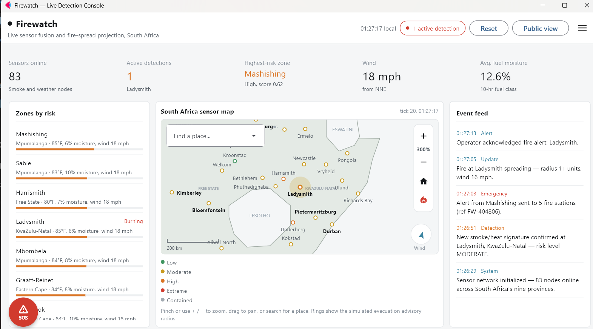
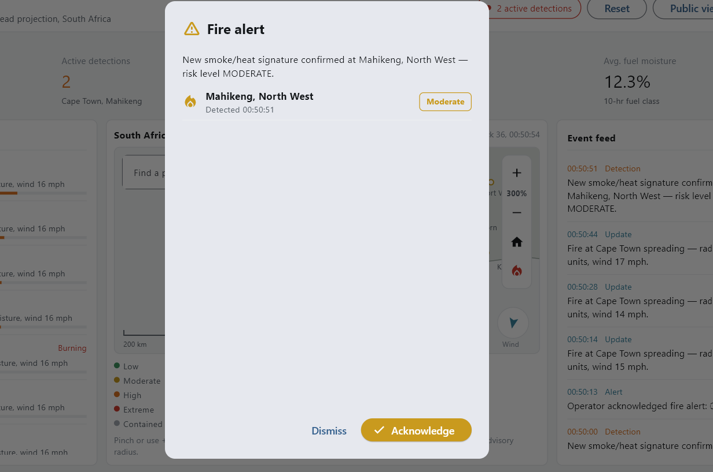
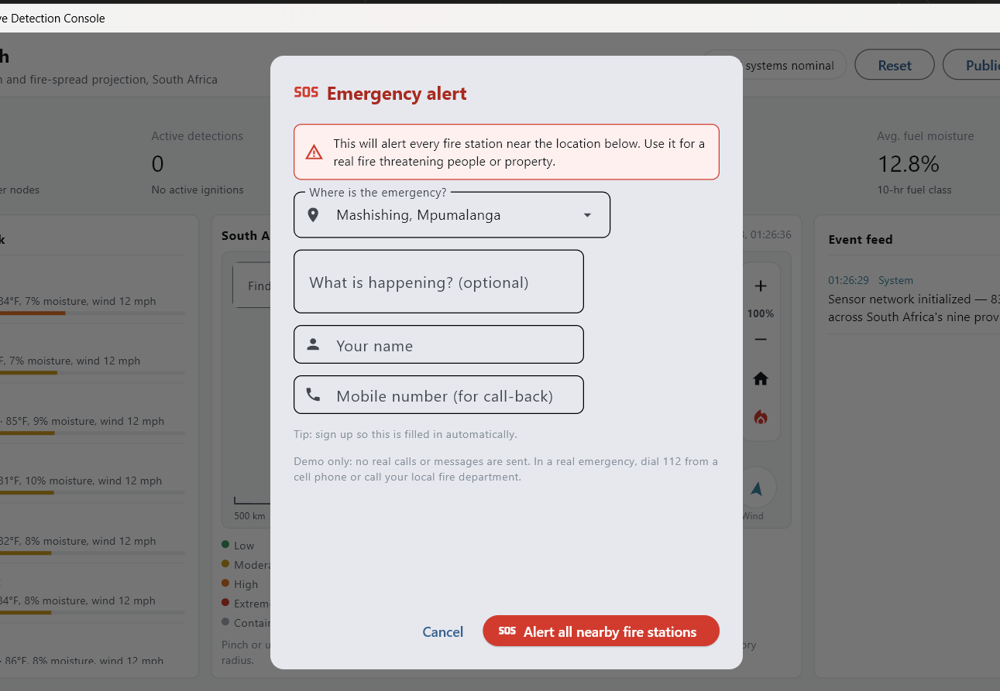
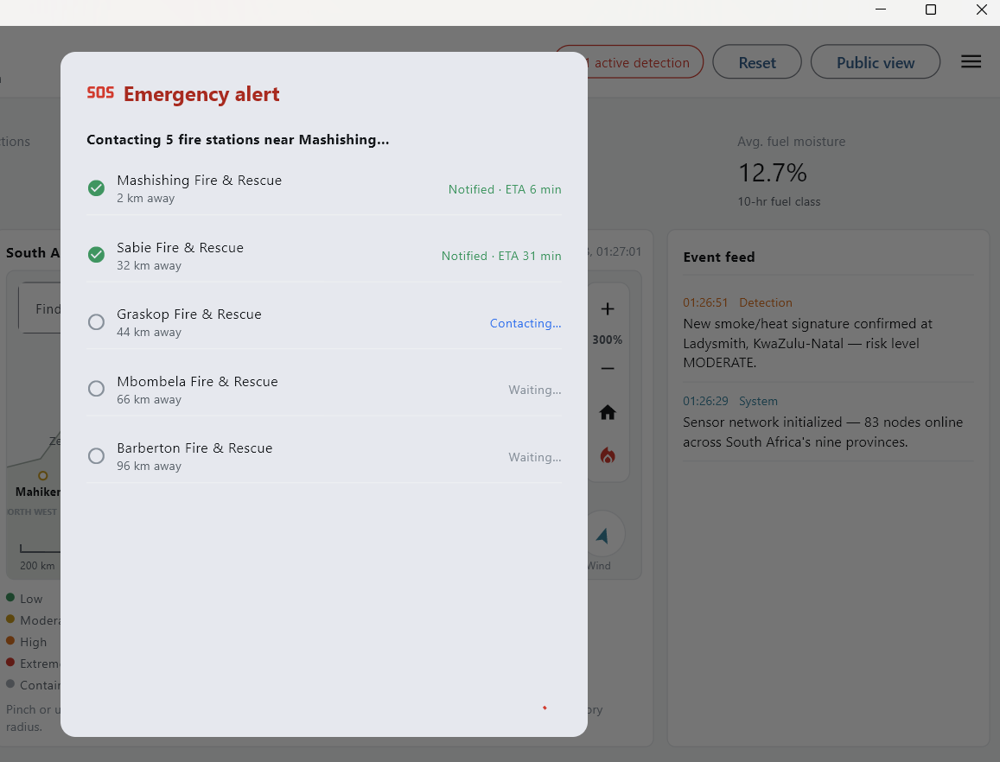
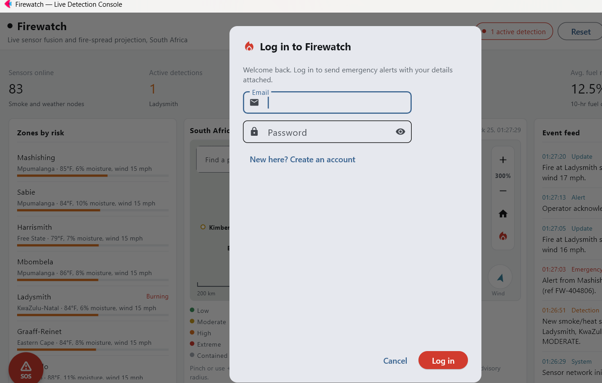
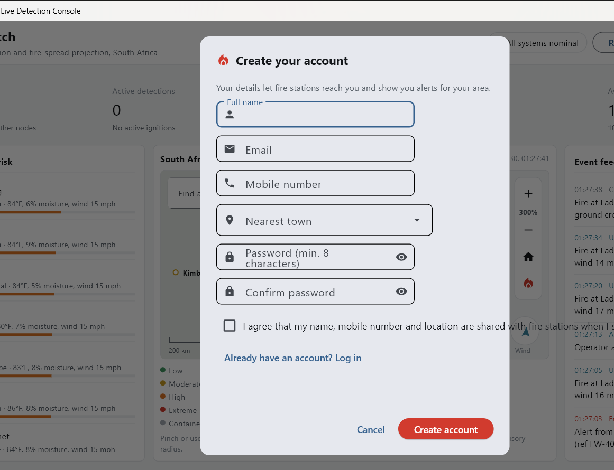

<p align="center"></p>

# Firewatch SA

A live wildfire-detection console for South Africa, built with Python and [Flet](https://flet.dev).
A simulated network of 83 sensor nodes across all nine provinces reports wind, temperature and fuel
moisture. The app turns that into risk levels, ignites and spreads simulated fires, and lets people
raise an emergency alert to nearby fire stations.

> **Demo only.** All data is generated by a built-in simulation and does not reflect real conditions.
> No real calls or messages are sent. In a real emergency, dial **112** from a cell phone or call your
> local fire department.

## Logo

The logo and every icon size (browser tab, installable app, loading screen, desktop window) are drawn by
`python tools/make_logo.py` and saved in `assets/`. Flet serves files in `assets/` instead of its own, so
this replaces the Flet icons. To use a different logo, replace the files in `assets/` (or edit the colours
and flame in `tools/make_logo.py`) and run the script again.

## Screenshots

**Live console**



| Fire alert popup | Emergency (SOS) form |
| :---: | :---: |
|  |  |

| SOS dispatch to nearby stations | Log in |
| :---: | :---: |
|  |  |

| Create an account |
| :---: |
|  |

## Features

- **Live sensor map** of South Africa: pinch or use + / − to zoom, drag to pan, search for a town, and
  jump to active fires. Rings show the simulated evacuation advisory radius.
- **Risk model** per town combining wind, fuel moisture, temperature and terrain slope into
  low / moderate / high / extreme levels.
- **Simulated fires** that ignite, spread with the wind and are eventually contained, with a running
  event feed and wind / moisture trend charts.
- **Fire alert popup** when a new fire is detected, with **Acknowledge** (logs it and zooms the map to
  the fire) and **Dismiss**. Fires that start together are batched into one popup, and it waits while
  another dialog is open.
- **Floating SOS button** that stays on screen while you scroll. It opens the emergency form and
  notifies every fire station within about 100 km, with an ETA for each.
- **Accounts**: sign up and log in so alerts carry your name, number and home town.
- **Console and Public views**: an operations dashboard and a simpler view for residents.
- **Responsive**: adapts to phones, tablets and desktops.

## Run it locally

Requires Python 3.10+.

```bash
pip install -r requirements.txt
python main.py
```

This opens a desktop window. If your PC blocks the desktop viewer, the app falls back to your browser.
To force browser mode:

```bash
# macOS / Linux
FIREWATCH_VIEW=web python main.py

# Windows (PowerShell)
$env:FIREWATCH_VIEW="web"; python main.py
```

## Deploy

- **Render / Railway / similar:** set `PORT` and run `python main.py`. See `render.yaml`.
- **Static web (Netlify, Vercel):** build with `flet build web` and publish the generated `build/web`
  folder. Accounts are then kept in each visitor's browser storage.

`build/` is generated output, so it is listed in `.gitignore`.

## Project layout

| File | What it does |
| --- | --- |
| `main.py` | App shell: layout, header, panels, simulation timer, alert popups |
| `firemap.py` | Interactive map widget (zoom, pan, search, fires, dispatch lines) |
| `dialogs.py` | Sign up, log in, profile, emergency dispatch and fire-alert dialogs |
| `simulation.py` | Sensor towns, risk model, fire ignition and spread |
| `stations.py` | Illustrative fire stations, nearest-station search and ETAs |
| `geo.py` | South Africa outline and lat/lon to map projection |
| `auth.py` | Local accounts with salted PBKDF2 password hashes |
| `ui.py` | Theme colours and small UI helpers |

## Notes and limits

- Fire station names and positions are **illustrative**, not an official register. Replace
  `build_stations()` in `stations.py` with a real dataset before relying on it.
- Accounts are stored in `~/.firewatch/users.json` (override with the `FIREWATCH_USERS` environment
  variable) or in browser storage on the web. That suits a demo; a real deployment needs a proper
  backend and auth provider.
